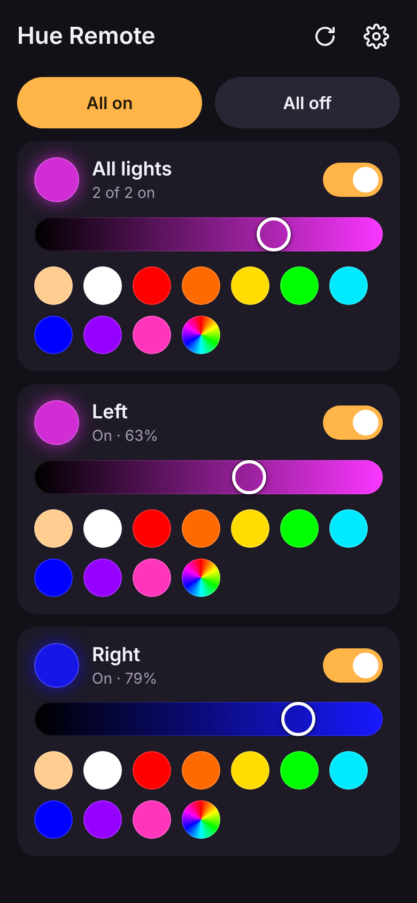
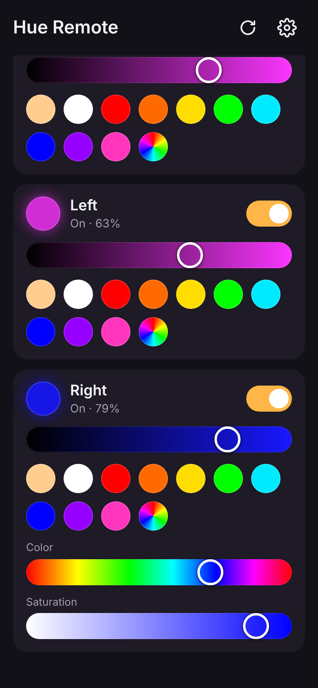
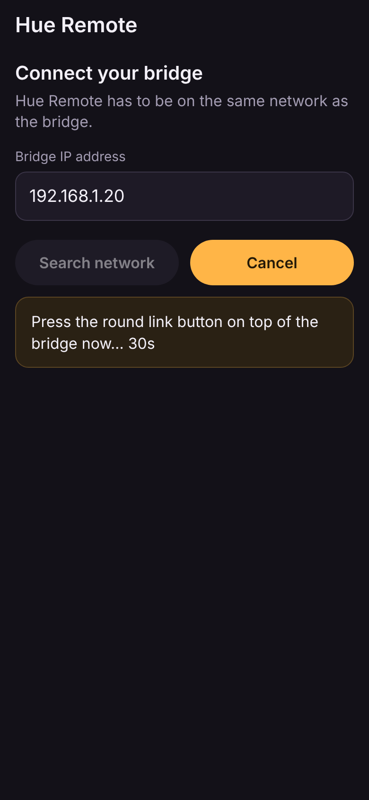
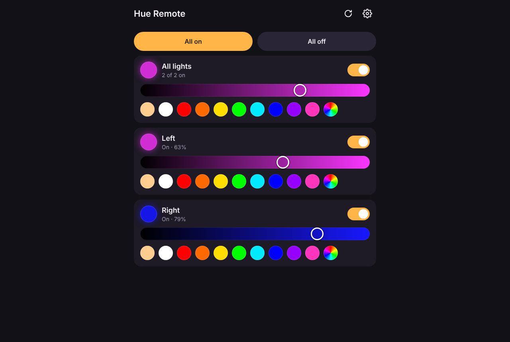

# Hue Remote

A no-nonsense remote for the original round Philips Hue bridge (v1, model `BSB001`).
Pair it once, then switch your lights on and off and set their colors from an Android
phone or any web browser.

There's no account, no cloud, no ads and no tracking. It only talks to the bridge on
your own network, using the bridge's local v1 API (the only API the v1 bridge has).

**Use it in your browser, nothing to install:** <https://funkedope.github.io/hue-remote/>
(Chrome or Edge on a computer; see [Browser version](#browser-version-no-install)).

<p>
  
  
  
</p>
<p>
  
</p>

**Download:** the Android APK and the Node.js web version are attached to each
[release](https://github.com/FunkeDope/hue-remote/releases). What changed in each
version is in [RELEASE_NOTES.md](RELEASE_NOTES.md).

## Contents

- [Features](#features)
- [What it works with](#what-it-works-with)
- [Browser version (no install)](#browser-version-no-install)
- [Android app](#android-app)
- [Web version (Node.js)](#web-version-nodejs)
- [Using it](#using-it)
- [How it works](#how-it-works)
- [Privacy and security](#privacy-and-security)
- [Building from source](#building-from-source)
- [Releasing a new version](#releasing-a-new-version)
- [Project layout](#project-layout)
- [Troubleshooting](#troubleshooting)

## Features

- **Pairing:** type the bridge's IP (or, in the app and the Node version, let it search
  the network), then press the bridge's link button.
- **Per light:** a power switch, brightness, 10 color presets, and hue and saturation
  sliders for any other color.
- **All lights at once:** an "All lights" card, plus All on and All off buttons.
- **White and dimmable bulbs:** a color-temperature slider for white-ambiance bulbs,
  brightness only for dimmable bulbs, and just the switch for plugs.
- **Status:** unreachable lights are flagged, and changes made elsewhere show up
  within 10 seconds.
- **Bridge info:** name, model, firmware, API version and Zigbee channel. You can also
  pair a different bridge or forget this one.
- **Three ways to run it, one UI:** the website, the Android app and the Node.js web
  version all run the same HTML/JS.
- **Tiny:** the APK is about 36 KB, and the web version has no npm dependencies.

## What it works with

| | |
|---|---|
| **Bridge** | Hue bridge v1 (round, `BSB001`) on its final firmware, `01043155` / API `1.16.0`. The v2 (square) bridge still serves the same local v1 API, so it should work too, but that hasn't been tested. |
| **Lights** | Color lights (Bloom, Iris, LivingColors, color bulbs), white-ambiance bulbs, dimmable white bulbs and smart plugs. Tested with Hue Living Colors Bloom (`LLC011`). |
| **Android** | 5.0 (Lollipop) or newer. |
| **Browser version** | Chrome or Edge 142 or newer on a computer. Firefox may work but hasn't been confirmed, and Chrome on Android hasn't been tested. Safari (Mac, iPhone, iPad) can't reach devices on your network from a website. |
| **Web version** | Node.js 18 or newer on Windows, macOS or Linux, and any current browser (built and tested with Chrome). |

## Browser version (no install)

Open **<https://funkedope.github.io/hue-remote/>** in Chrome or Edge on a computer
that's on the same network as the bridge. Anyone can use the same link; each person
pairs with their own bridge.

1. Type the bridge's IP address. A web page can't search the network, but your
   router's list of connected devices shows it.
2. Click **Pair**. When the browser asks to let the site access devices on your local
   network, choose **Allow**.
3. Press the round button on top of the bridge within 30 seconds.

The pairing is saved in that browser's localStorage, so next time the page opens
straight to your lights. There's no account and no server behind it: the page is a few
static files on GitHub Pages, and your browser talks directly to your bridge.

**Why this works at all:** the site is HTTPS, but the v1 bridge only speaks plain HTTP,
which browsers normally block from secure pages. Chrome and Edge 142+ make an exception
for devices on your local network once you allow the site to access them (their Local
Network Access permission). The bridge also has to tell the browser that other websites
may read its replies (CORS), which Hue bridges do with `Access-Control-Allow-Origin: *`.
If it doesn't work for you, see
[the troubleshooting entry](#the-website-says-no-bridge-answered).

## Android app

### Install

1. On the phone, open the [latest release](https://github.com/FunkeDope/hue-remote/releases/latest)
   and download `hue-remote-<version>.apk`.
2. Open the downloaded file. Android will ask you to allow installs from your browser
   or Files app. Allow it.
3. Play Protect may warn that it doesn't recognize the developer. Tap
   **More details → Install anyway**.

If the phone won't sideload at all, install it from a computer instead:
`adb install hue-remote-<version>.apk`.

### Pair

1. Connect the phone to the same Wi-Fi as the bridge and open **Hue Remote**.
2. Type the bridge's IP address (your router's device list shows it), or tap
   **Search network**.
3. Tap **Pair**, then press the round button on top of the bridge within 30 seconds.

The pairing is saved, so from then on the app opens straight to your lights.

### Updating

A new APK installs over the old one only if both were signed with the same key. If
Android says **App not installed**, uninstall the old version first. You'll just need
to pair again. (See [Signing key](#signing-key) to keep releases updatable in place.)

## Web version (Node.js)

The web version is a small Node.js server. It serves the same UI as the Android app and
relays its requests to the bridge, so it works in any browser without CORS or
mixed-content problems.

### Run it

1. Install [Node.js](https://nodejs.org/) 18 or newer.
2. Download `hue-remote-web-<version>.zip` from the
   [latest release](https://github.com/FunkeDope/hue-remote/releases/latest) and
   unzip it (or clone this repo).
3. In a terminal in that folder, run:

   ```sh
   npm start
   ```

4. Open <http://localhost:8080/> in Chrome and pair the same way as on Android.

There's nothing to `npm install`. To stop it, press **Ctrl+C**.

### Options

```sh
npm start -- --port 9000     # use a different port (default 8080)
npm start -- --lan           # also let phones and tablets on your network open it
node server/server.js --help
```

| Setting | Flag | Environment variable |
|---|---|---|
| Port | `--port 9000` | `PORT=9000` |
| Serve to the whole network | `--lan` | `HUE_LAN=1` |
| Where settings are saved | | `HUE_CONFIG=C:\path\to\config.json` (default `server\config.json`) |
| Extra host names to answer to | | `HUE_ALLOWED_HOSTS=hue.home,lights.lan` |

PowerShell sets environment variables like this: `$env:PORT = 9000; npm start`.

### Using it from other devices

Start it with `npm start -- --lan`. The terminal prints the addresses to use, for
example `http://192.168.1.50:8080/`. Open one on your phone. Windows may ask whether
to let Node.js through the firewall. Allow it on **private** networks.

The pairing is stored on the server, so every browser that opens the page is already
paired. That also means anyone on your network who can open the page can control your
lights.

## Using it

- **Power switch:** turns that light on or off.
- **Brightness slider:** dims the light, and turns it on if it was off.
- **Color dots:** warm white, white, red, orange, yellow, green, cyan, blue, purple
  and pink.
- **Rainbow dot** (or tapping the light's name): opens hue and saturation sliders for
  any other color.
- **All lights card:** shown when you have two or more lights. Anything you set there
  applies to every light.
- **All on / All off:** switch every light together.
- **Refresh button:** reloads the lights now. They also refresh every 10 seconds and
  whenever you come back to the app.
- **Gear button:** shows bridge details and lets you pair a different bridge or forget
  this one.

## How it works

The UI in [`web/`](web) is plain HTML, CSS and JavaScript. In the Android app and the
Node version it does everything through a small `window.Native` object. On the website
there isn't one, so the page calls the bridge itself:

```
Android:  web/ in a WebView ──window.Native──▶ MainActivity.java ──HTTP──▶ bridge
Node:     web/ + shim.js    ──POST /native/*─▶ server/server.js  ──HTTP──▶ bridge
Website:  web/ on GitHub Pages ──fetch()──────────────────────────────────▶ bridge
```

`window.Native` has five methods: `http` (send a request to the bridge), `discover`
(find bridges), `getPref` and `setPref` (saved settings), and `deviceName`. Going
through it sidesteps CORS and Android's cleartext rules, and lets discovery use UDP,
which a web page can't. Without it, the page uses `fetch()` (marked as a local network
request for Chrome) and `localStorage`, and hides **Search network**.

The Hue v1 API calls it makes:

| What | Request |
|---|---|
| Pair | `POST /api` with `{"devicetype":"hue_remote#<device>"}`. It returns error 101 until the link button is pressed, then a username. |
| List lights | `GET /api/<username>/lights` |
| Change a light | `PUT /api/<username>/lights/<id>/state` with `on`, `bri`, `hue`, `sat`, `ct`, `transitiontime` |
| All on / off | `PUT /api/<username>/groups/0/action` (group 0 is every light) |
| Bridge details | `GET /api/<username>/config` |
| Find bridges | SSDP `M-SEARCH` to `239.255.255.250:1900`, then `GET /description.xml` on each address in the local /24 |

Slider drags fire far faster than the bridge can keep up with (about 10 commands a
second). So changes are merged per light, sent round-robin at most every 100 ms, and
never sent twice at once for the same light.

## Privacy and security

- **What's stored:** the bridge's IP address and the username it issued at pairing. On
  Android that's in the app's private storage. On the website it's that browser's
  localStorage. In the Node version it's `server/config.json`.
- **Network traffic:** only to the bridge. Search sends one SSDP multicast and, if
  nothing answers, requests `/description.xml` from each address on your subnet.
  Nothing goes to the internet.
- **Website:** your browser downloads the page from GitHub Pages like any other site,
  then talks only to your bridge. Your bridge's address, pairing and lights never go to
  GitHub or anywhere else. The page's Content-Security-Policy only allows its own
  scripts and styles.
- **Web server:**
  - Listens on `127.0.0.1` only, unless you start it with `--lan`.
  - Only forwards requests to `/api` on a private (LAN) IP address. With `--lan`, it
    won't forward to this computer itself (localhost or its own LAN addresses).
  - Only answers when addressed as `localhost`, an IP address, or this computer's own
    name. That blocks DNS-rebinding tricks.
  - Its `/native/*` endpoints accept same-origin JSON requests only, so other websites
    open in your browser can't call them.
- **Forget this bridge** clears the pairing in the app. The bridge keeps the app's
  entry in its list of authorized apps (its whitelist) until you remove it with the v1
  API: `DELETE /api/<username>/config/whitelist/<username>`.

## Building from source

### Android

The APK is built with the Android tools Debian and Ubuntu package, with no Gradle or
Android Studio. On Ubuntu or WSL:

```sh
sudo apt install openjdk-21-jdk-headless zip android-sdk-platform-23 aapt dalvik-exchange zipalign apksigner
android/build.sh      # writes android/build/hue-remote.apk
```

The script compiles the resources (`aapt2`), the Java (`javac --release 8`) and the dex
(`dx`). It packages `web/` as the app's assets, then aligns and signs the APK. It signs
with `~/.android/debug.keystore`, creating it if needed, unless you set `KEYSTORE`,
`KEYSTORE_PASS` and `KEY_ALIAS`.

### Web version

There's nothing to build. `npm start` runs it straight from the source.

### Website

`npm run site` copies `web/` into `site/` and adds the Content-Security-Policy. Every
push to `main` that changes `web/` publishes it to GitHub Pages through
[`.github/workflows/pages.yml`](.github/workflows/pages.yml).

### Tests and the fake bridge

```sh
npm test       # server tests, run against the fake bridge
npm run mock   # a fake v1 bridge on port 8123, with two lights
```

To work on the UI without the real bridge, run `npm run mock` and `npm start` in two
terminals. Then open <http://localhost:8080/> and pair with `localhost:8123`. The fake
link button counts as pressed on the third try.

## Releasing a new version

1. Bump the version in `package.json` and in `android/AndroidManifest.xml`
   (`versionName`, and `versionCode` +1). The two have to match.
2. Add a `## <version> (<date>)` section at the top of `RELEASE_NOTES.md`.
3. Commit and push to `main`.

On every push to `main`,
[`.github/workflows/release.yml`](.github/workflows/release.yml) checks whether that
version has a release yet. If not, it runs the tests, builds the APK and the web zip,
creates the `hue-remote-v<version>` tag, and publishes a GitHub release with that
version's notes and SHA-256 checksums. Pushes that don't change the version do
nothing. Pushing a `hue-remote-v*` tag yourself also triggers a release.

### Signing key

Without a signing key set up, each release's APK is signed with a new throwaway key,
so installing it means uninstalling the previous one first. To make updates install in
place, create a key once and store it as repository secrets:

```sh
keytool -genkeypair -keystore hue-remote.keystore -alias hue-remote \
  -keyalg RSA -keysize 2048 -validity 10000 -dname "CN=Hue Remote"
base64 -w0 hue-remote.keystore    # PowerShell: [Convert]::ToBase64String([IO.File]::ReadAllBytes("hue-remote.keystore"))
```

Then, in the repo, go to **Settings → Secrets and variables → Actions** and add two
secrets:

- `HUE_REMOTE_KEYSTORE`: the base64 text.
- `HUE_REMOTE_KEYSTORE_PASSWORD`: the password you chose.

Keep the keystore file somewhere safe. If you lose it, you can't publish updates that
install over the old version.

## Project layout

```
android/
  AndroidManifest.xml
  src/life/skiddie/hueremote/MainActivity.java   WebView host: HTTP, discovery, settings
  res/                                           app name, theme, launcher icon
  build.sh                                       builds the APK (no Gradle)
web/                                             the UI, shared by all three versions
  index.html  style.css  app.js  icon.svg
server/
  server.js                                      web version: serves web/, relays to the bridge
  shim.js                                        window.Native for the browser
dev/mock-bridge.js                               fake v1 bridge for development and tests
scripts/build-site.js                            builds the website (npm run site)
test/server.test.js                              npm test
docs/screenshots/
.github/workflows/pages.yml                      publishes the website to GitHub Pages
.github/workflows/release.yml                    builds and publishes releases on version bumps
RELEASE_NOTES.md
```

## Troubleshooting

### The website says "No bridge answered"
- Use Chrome or Edge 142 or newer on a computer, on the same network as the bridge.
- If you blocked the local network prompt, click the icon at the left of the address
  bar, open the site settings, set **Local network access** to **Allow**, and reload.
- Check that your bridge allows other websites to read its replies. In PowerShell:

  ```powershell
  (Invoke-WebRequest http://<bridge-ip>/api/config -UseBasicParsing).Headers['Access-Control-Allow-Origin']
  ```

  It should print `*`. If it prints nothing, the website can't work with that bridge;
  use the Android app or the Node version instead.

### "No bridge answered at …"
Check the IP address, and that the phone or computer is on the same network as the
bridge (not a guest network). If the bridge's IP keeps changing, give it a fixed
address (a DHCP reservation) in your router.

### Search network finds nothing
Some routers block device discovery between Wi-Fi clients, and on Windows the
firewall can block the replies. Type the IP address instead.

### Pairing times out
Press the round button on the bridge after tapping **Pair**. It has to happen within
the 30-second countdown.

### A light says "Unreachable"
The bridge can't reach it over Zigbee. Usually it's switched off at the wall, or too
far from the bridge and the other lights.

### "The bridge doesn't recognize this app anymore"
The bridge was reset or the app was removed from its whitelist. Pair again.

### Android says "App not installed"
The installed copy was signed with a different key. Uninstall it, then install the
new APK.

### "Port 8080 is already in use"
Something else is using that port. Run `npm start -- --port 8081`.
